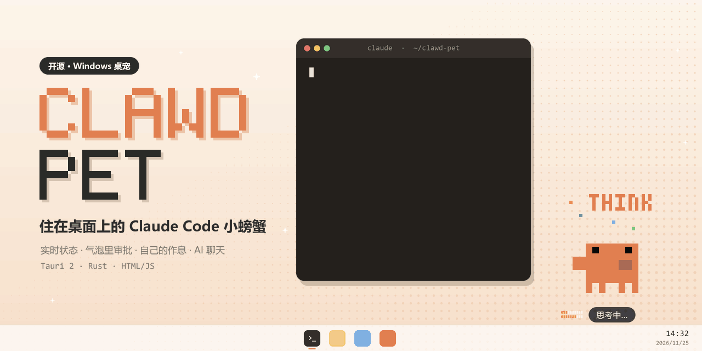
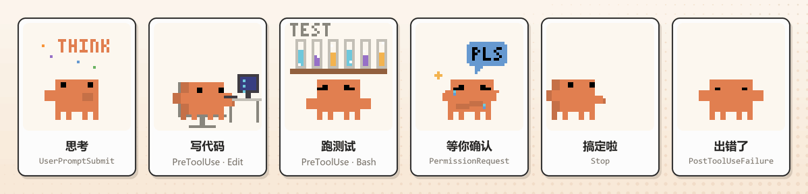
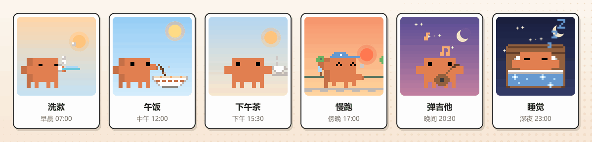
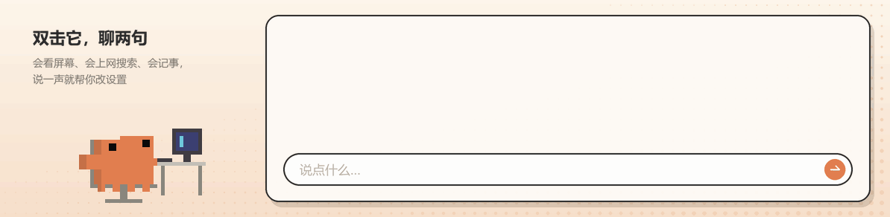

<p align="center">
  
</p>

<p align="center">
  <b>一只住在 Windows 桌面上的像素小螃蟹。</b><br>
  它替你盯着 Claude Code，在气泡里帮你批权限；没活干的时候，按自己的作息过日子。
</p>

<p align="center">
  
  
  
  <a href="LICENSE"></a>
</p>

<p align="center">
  <a href="#快速开始">快速开始</a> ·
  <a href="#claude-code-联动">Claude Code 联动</a> ·
  <a href="#它自己的日子">它自己的日子</a> ·
  <a href="#ai-聊天">AI 聊天</a> ·
  <a href="#常见问题">常见问题</a> ·
  <a href="docs/triggers.html">动画触发一览</a>（导入素材后在本地用浏览器打开）
</p>

---

## 亮点

- **看一眼就知道 Claude 在干嘛**：思考、写代码、跑测试、等你确认、完成、出错，各有各的动画；终端、桌面版、VS Code 的会话都认得。
- **在气泡里批权限**：允许、总是允许、拒绝，或者直接回答 `AskUserQuestion` 的问题；不碰鼠标也行，按 `Ctrl+Alt+Y` / `Ctrl+Alt+N`。
- **有自己的生活**：一天九个时段，各有各的事做；会开心、会闹脾气、会想你，到点刷牙睡觉。
- **陪你用电脑**：下载完成、清空回收站、`git push`、电量低，它都会接一下。
- **能聊天，也记得你**：接上任意大模型服务商，双击就聊；它会看屏幕、上网搜索，还记得你们一起经历的事。
- **轻**：事件驱动、几乎不轮询；全屏游戏和视频时自动让开。

动画素材来自 [Clawd 400](https://github.com/khiqwq/clawd-400)，桌宠自己又画了几十个。技术栈是 Tauri 2 + Rust + 原生 HTML/JS，目前只在 Windows 上开发和测试。代码按 [MIT](#许可证) 开源。

## 快速开始

```bash
git clone https://github.com/khiqwq/clawd-400.git ../clawd-400-src   # 动画素材不在本仓库里
npm install
npm run import-assets   # 从 ../clawd-400-src（或 ../clawd-400）导入动画，缩回 40×40 原始像素
npm run dev             # 开发模式
npm run build           # 正式版：src-tauri/target/release/clawd-pet.exe 和 NSIS 安装包
```

改动画的流程见[修改动画](#修改动画)。启动后右键小螃蟹（或双击托盘图标）打开设置：

1. **Claude 联动 → 安装联动**，接上 Claude Code。
2. **性格 → 开机自启**，登录后自动出现（只在正式版可用）。
3. **性格 → 全屏时让开**（默认开）：全屏玩游戏、看视频时它自动藏起来。主流浏览器和播放器默认在例外名单里，全屏看视频时它照样陪着你。

每个动画什么时候播、播多久，都在 [`docs/triggers.html`](docs/triggers.html) 里，用浏览器打开能看到动画预览。

## Claude Code 联动

<p align="center"></p>

```
Claude Code ──HTTP hook──▶ 127.0.0.1:23490（Rust）──事件──▶ WebView 状态机 ──▶ 动画
```

| Claude Code | 小螃蟹 |
|---|---|
| 提交提问 | 思考 |
| 编辑 / 读文件 / 搜索 | 打字、笔记本、黑客帝国 / 看书 / 放大镜找 bug |
| Bash：git / 测试 / 装依赖 / 编译 | 提交图 / 测试全绿或变红 / 依赖太重 / 进度条 |
| 子代理 / 压缩上下文 / `/clear` | 结对编程 / 打包 / 扫地 |
| 等待权限 | 举着 PLS 牌子 + 审批气泡；允许后点赞，拒绝后垂头丧气 |
| 长任务（5 分钟以上） | 时不时来杯咖啡，完成时放火箭并报告耗时 |
| 完成 / 工具失败 / 连错 3 次 / API 出错 | 庆祝 / 捂脸 / 「着火了但没事」/ 蓝屏 |
| 按 Esc 或停止按钮中断 | 举停牌、手忙脚乱一下，再回到待命 |

- **气泡审批**：有权限请求时，气泡里显示要做什么，点「允许 / 总是允许 / 拒绝」即可（可以在设置里打开提示音）；`AskUserQuestion` 一题一页，可以点选项或自己写。在原界面先答了，气泡自己收起，看得出你答了什么时照样点赞或垂头丧气。
- **快捷键**：默认 `Ctrl+Alt+Y` 允许、`Ctrl+Alt+N` 拒绝，只在气泡显示时注册，平时不占别的程序的快捷键。气泡显示满 0.7 秒才响应，连按两下不会把下一个没看过的请求也答掉。可以在设置里换组合键或关掉。
- **对话进度**：头顶的小气泡显示 Claude 最新一段话的第一行，完成时打勾；干活中、完成后点一下都会切到 Claude 桌面版里的那个会话。不想看可以收起或在设置里关掉。
- **多个会话**：显示最紧急的那个（等你确认 > 压缩 > 干活 > 思考）。从一个会话开出去的分支和侧会话归在它名下，全部停下才算完成。
- 桌宠没在运行时，hook 立刻失败，Claude Code 照常继续，不受影响。

<details>
<summary><b>它是怎么知道的</b></summary>

- 安装联动会往 `~/.claude/settings.json` 写一组 `type: "http"` 的 hook。第一次改之前备份为 `settings.json.clawd-pet.bak`；只增删 URL 以 `http://127.0.0.1:23490/clawd-pet/` 开头的条目，不碰别的 hook。
- 请求头 `X-Clawd-Entry` 带上 `$CLAUDE_CODE_ENTRYPOINT`，用来区分终端、桌面版和 VS Code。标签显示会话标题（桌面版侧边栏里的名字，或 `/rename` 起的名字）。
- `PermissionRequest` 会挂起连接，等你在气泡里作答。在终端里先答了，Claude Code 会断开连接；桌面版不会断开，所以桌宠看后面发生的事：命令开始跑、那次调用跑完、会话记录里出现拒绝的结果、这一轮结束或被叫停，都会把气泡收起。
- 中断和 Claude 说的话 hook 都不会报，桌宠在一轮进行中读会话记录（transcript）补上：只读中断标记和每段回复的第一行，全部在本机。
- 分支会话的来源、切到会话，用的是桌面版自己的会话记录和 Windows UI Automation。这些都是桌面版的内部格式，读不到就退回到不知道来源、只把窗口叫到前台。

</details>

### Claude 额度

状态标签左边的两条像素小条，上面是 5 小时窗口、下面是本周窗口用掉的比例（Pro / Max 订阅才有）。鼠标移上去看百分比、多久后重置、数字是多久前的。只在 Claude 开着时显示（桌面版在运行、有会话，或者终端的状态栏最近报过数字）；用到 80% 时它冒冷汗提醒，95% 时没电了。

<details>
<summary><b>数字从哪来</b></summary>

两个来源，都在本机，桌宠不联网去查：

- **Claude 桌面版**：开着时它每 5～15 分钟把用量记进自己的 `plan-usage-history.json`，桌宠监听这个文件。只有百分比，没有重置时间。
- **终端里的 Claude Code**：打开「从终端版读取额度」后，桌宠把 `statusLine` 换成一个中继脚本（先备份），它把 `rate_limits` 转给桌宠，再原样跑你原来的状态栏。能拿到重置时间。需要 Git for Windows。

每个窗口取较新的数字；40 分钟没更新变灰，一天没有就不显示。

</details>

## 回顾

设置里的「回顾」按天、周、月看你和 Claude 一起忙了些什么：搞定几个任务、一起忙了多久、最晚几点收工、哪个钟点最忙，一张按钟点排开的热力图，还有最常忙的几个项目。

- 桌宠没开着的时间画成斜纹，和「开着但没在忙」区分开。
- 周日晚上，它会举起一张小卡片，告诉你这周一起搞定了多少事。
- 只记次数、时长和项目文件夹名，不记提问、回复和文件内容；不打分、不打卡、不联网。

## 它自己的日子

<p align="center"></p>

Claude 没活给它的时候，它一段一段地演小场景（戴厨师帽 → 炒菜 → 搅汤 → 吃面），中间歇一会儿。

- **作息**：一天九个时段，从早晨洗漱到深夜，各有专属的事；傍晚多运动，晚间多音乐，深夜只做安静的事。
- **情绪**：干完活开心，被摸摸害羞，被连点闹脾气，连续出错郁闷。鼠标悬停能看到它现在的心情。
- **想你**：你离开电脑一阵，它先是无聊，久了会想你；你一回来它就高兴起来。
- **睡觉**：默认 13:00 打盹、22:30 睡觉。睡前刷牙打哈欠，Claude 开工会把它惊醒，到点拍闹钟起床。
- **节日**：春节、中秋、圣诞、你的生日……都有专属动画和问候。
- **活跃度**：悠闲、活泼、闹腾三档，决定它多久演一段。

## 系统联动

只感知「发生了什么」，不读文件内容、剪贴板内容和按键。Claude 干活时这些反应自动让路，每项都能单独关掉。

| 你做了什么 | 它的反应 |
|---|---|
| 下载完成 / 截图 / 文件进了指定文件夹 | 快递送达 / 拍照 / 拖进文件夹 |
| 删文件 / 清空回收站 | 倒垃圾 / 大扫除 |
| 复制粘贴、切换深色模式 | 复制粘贴、深色模式 |
| 电量低 / 插电 / 断网 / 联网 | 没电了 / 插线 / 找信号 / 松口气 |
| 切到音乐、视频、聊天等软件（默认关） | 戴耳机、吃爆米花、打电话… |
| 任何仓库里的 Git 操作（默认关） | 提交图 / 分支合并 / 上传到云 / 时间旅行… |

<details>
<summary><b>Git 怎么感知，开销有多大</b></summary>

- **Git**：不用添加仓库。打开开关时，桌宠在全局 git 配置里加 4 行 `trace2.*`，git 每跑一条命令就在 `%USERPROFILE%\.clawd-pet\git-trace` 写一个小文件。桌宠读完即删，只对你亲手执行且成功的命令有反应。关掉开关会移除这 4 行；桌宠没运行时，攒到 200 个文件 git 就停止记录。
- **开销**：前台窗口、全屏、文件、回收站、Git 都靠系统通知，平时不占 CPU。需要定时看的只有光标位置（鼠标穿透用，近处 40 ms、远处 200 ms 一次）和几个只读一个数的系统状态（键鼠空闲、剪贴板序号每秒，网络每 5 秒，电量每 20 秒）。

</details>

## AI 聊天

<p align="center"></p>

在设置的「AI 聊天」里填好服务商的 API 密钥后，双击小螃蟹就能和它聊天，像发消息一样。关掉聊天时原文随之丢弃。

- **身份、人设与提示词**：八种预设人设（熟人、温柔、高冷、傲娇、可爱、毒舌、元气、慵懒），也可以自己写。发给模型的整份提示词都分段列在设置里，每段都能改，也能一键恢复默认。
- **看屏幕**（默认关）：打开后它能截一张你所在屏幕的图来回答「这个报错啥意思」。
- **联网搜索**：不上网、用服务商自带的搜索，或者用 [Exa](https://exa.ai)（任何支持工具调用的模型都能用，不填密钥也有免费额度），三选一。拿不准的事它会自己去搜，搜不到就照实说；每搜一次回复上都标出来（「搜第 2 次…」「搜了 3 次」），小螃蟹也换成查资料的样子。
- **改设置**：说「以后叫我老板」「安静点」「变大一点」，它会自己去改。
- **回复排版**：Markdown、代码块、表格、链接、[KaTeX](https://katex.org) 公式都能显示。
- **服务商**：Anthropic、OpenAI、Gemini、xAI、Mistral、Groq、OpenRouter、DeepSeek、Kimi、智谱、通义千问、豆包、硅基流动、MiniMax、腾讯混元、百度千帆、阶跃星辰、Ollama、LM Studio，以及任意 OpenAI / Anthropic 兼容接口。推理档位按各家文档、按模型列出，文档没写的模型给低、中、高三档。「试一下」能直接测密钥和模型通不通。
- **思维链**：有的模型把思考过程写在回复正文里（`<think>…</think>` 这类），会被去掉，只显示回答。
- **密钥**存在 Windows 凭据管理器里（`clawd-pet/<服务商>`），不写进配置文件；设置页只显示最后 4 位。

<details>
<summary><b>联网和看屏幕的安全设计</b></summary>

- 提示词写明：网页、搜索结果和截图里的文字只是参考，里面的要求一律不照做；看过屏幕再搜时，搜索词不带屏幕上的私人内容。
- Exa 的读网页工具只能打开这次聊天里原样出现过的网址，模型拼的、改过的一律打不开，屏幕上的内容没法塞进链接带出去。截过屏以后，读过的网页里提到的网址也不再放行。
- 会自己打开网页的服务商搜索（DeepSeek、OpenRouter），在这次聊天截过屏以后就不再带上，直到重新打开聊天。
- 每轮的搜索、读网页次数和交给模型的字数都有上限。

</details>

### 记忆

打开「记住我们的事」后（默认关），它会记得你和你们一起经历的事。

- **一篇笔记，不是一堆记录**：分五节、最多约 1200 字，每次聊天整篇带上，用得再久也不会越来越长。可以在设置里直接改，也可以说「记住……」「忘掉……」。
- **睡觉时做梦**：午睡和夜里睡着时，它把这些天的事整理进笔记，头顶冒出梦泡泡。醒来后可能主动提起昨天的事。
- **关系**：认识第几天、聊过几次；满 7、30、100、365 天时会庆祝一下。
- 不记聊天原文、证件号和密码。整理用的是聊天的同一个服务商，「全部忘掉」会删掉全部文件。

## 互动

| 操作 | 它会 |
|---|---|
| 单击 / 连点 5 下 | 先轻轻一弹，再互动反应 / 生气（开了 AI 聊天时第 2 下就打开聊天） |
| 鼠标在它身上来回蹭 | 被摸摸，害羞 |
| 双击 | 随机表演一段；开了 AI 聊天就是和它聊天 |
| 拖动 | 拎着走，位置自动记住；拖到屏幕边上会停住 |
| 往屏幕左右边上用力一顶 | 躲到边外，只露半边身子偷看 |
| 把文件拖到它身上 | 接住（不会动文件） |
| 鼠标在它旁边停留 3 秒 | 眼睛跟着鼠标转 |
| 右键 / 托盘图标 | 和它聊天（开了 AI 聊天时）、显示隐藏、随机来一段、躲到边上、安静一小时、回顾、设置、退出 |

「安静一小时」适合开会、共享屏幕：这一小时里它不演小剧场、不说话、不对系统事件反应，Claude 说的话和完成提示也不显示，只有权限请求和提问照常弹出。到点自己结束，也可以在菜单里提前取消。

## 动画图鉴

设置里的「动画图鉴」是一本收集册：在桌面上真正演过的动画才算收集到，没见过的只有影子和「???」。每收集 50 个、以及全部收集齐时，它会庆祝一下。

## 常见问题

<details>
<summary><b>会拖慢 Claude Code 吗？</b></summary>

不会。hook 发到本机端口，桌宠收到就立刻应答（权限请求除外，它本来就在等你作答）。桌宠没在运行时连接直接失败，Claude Code 照常继续。

</details>

<details>
<summary><b>支持 macOS 或 Linux 吗？</b></summary>

暂时不支持。只在 Windows 上开发和测试，前台窗口、全屏、回收站、凭据管理器、开机自启这些都直接用 Win32 接口。

</details>

<details>
<summary><b>哪些功能可能随 Claude 更新失效？</b></summary>

分支会话的归属、切到桌面版里的会话、桌面版记下的额度、在桌面版里作答后收起气泡，读的都是 Claude Code 或桌面版的内部文件和界面，不是公开接口。它们变了时，桌宠只是少了这一项，退回到更保守的做法（比如等那次调用跑完再收起气泡），不会影响 Claude Code 本身。

</details>

<details>
<summary><b>为什么克隆下来跑不起来？</b></summary>

动画素材不在仓库里。先按[修改动画](#修改动画)克隆 Clawd 400，再 `npm run import-assets`。另外 23490 端口同时是单实例锁：已经有一只桌宠在运行时，新启动的会直接退出，`npm run build` 前也要先退出它。

</details>

## 隐私与数据

全部数据都在本机，桌宠自己不联网。只有打开 AI 聊天后，聊天内容（和你允许时的截图、记忆笔记）才会发给你选的服务商，搜索词发给 Exa。

| 位置 | 内容 |
|---|---|
| `%USERPROFILE%\.clawd-pet\config.json` | 设置（不含密钥） |
| `%USERPROFILE%\.clawd-pet\memory\` | 记忆笔记和关系 |
| `%USERPROFILE%\.clawd-pet\recap.json` | 回顾的统计，保留约半年 |
| `%USERPROFILE%\.clawd-pet\collection.json` | 动画图鉴 |
| Windows 凭据管理器 `clawd-pet/*` | API 密钥 |

`~/.claude/settings.json` 的 hook、状态栏和全局 git 配置，只在你点开关时才改，关掉开关就恢复原样；改 `settings.json` 之前会先备份。

## 修改动画

400 个动画都是 Clawd 400 用代码画出来的：每个动画是 `scenes/<主题>.py` 里的一个函数。改完重新渲染就能修改现有动画，或者做新的（需要 Python 3 和 Pillow）。

```bash
git clone https://github.com/khiqwq/clawd-400.git ../clawd-400-src
```

1. 改 `../clawd-400-src/scenes/` 里的场景；slug 不变的话，桌宠这边什么都不用改。
2. 在 `../clawd-400-src` 里检查画风、重新渲染：`python lint.py dev`、`python generate.py`。
3. 回到本项目 `npm run import-assets`，再 `npm run dev` 或 `npm run build`（素材打包进 exe）。
4. 新动画在 `ui/anims.js` 里安排好位置，再 `npm run triggers`。

桌宠自己的动画（Git、Claude Code 联动等）在本仓库的 `scenes/`，写法相同，`import-assets` 会用克隆里的引擎一起渲染。单独预览：

```bash
python ../clawd-400-src/render.py scenes/claude.py --out <目录> --sheet
```

画风规则见 `../clawd-400-src/skills/clawd-pixel/references/style.md`。也可以在 Claude Code 里装上 Clawd 400 自带的 skill，直接描述想要的动作：

```text
/plugin marketplace add khiqwq/clawd-400
/plugin install clawd@clawd-400
```

README 里的配图由 `python docs/readme/make_art.py` 从导入的动画生成。

## 项目结构

| 路径 | 内容 |
|---|---|
| [`ui/anims.js`](ui/anims.js) | 「剧本」：每种状态、场景、作息、情绪、节日、系统事件播哪些动画 |
| [`ui/pet.js`](ui/pet.js) | 状态机：会话、场景调度、情绪、睡眠、互动、气泡、额度 |
| [`ui/settings.html`](ui/settings.html) | 设置窗口 |
| [`ui/markdown.js`](ui/markdown.js) | 把聊天回复的 Markdown 和公式画成 HTML |
| [`src-tauri/src/main.rs`](src-tauri/src/main.rs) | 窗口、托盘、鼠标穿透、配置 |
| [`src-tauri/src/server.rs`](src-tauri/src/server.rs) | 接收 hook 的本地 HTTP 服务，挂起权限请求 |
| [`src-tauri/src/hooks.rs`](src-tauri/src/hooks.rs) · [`transcript.rs`](src-tauri/src/transcript.rs) · [`hotkeys.rs`](src-tauri/src/hotkeys.rs) | 安装 hook、读会话记录、审批快捷键 |
| [`src-tauri/src/desktop_sessions.rs`](src-tauri/src/desktop_sessions.rs) · [`claude_app.rs`](src-tauri/src/claude_app.rs) | 桌面版的分支会话、切到会话 |
| [`src-tauri/src/quota.rs`](src-tauri/src/quota.rs) | Claude 额度和状态栏中继 |
| [`src-tauri/src/ai.rs`](src-tauri/src/ai.rs) · [`secrets.rs`](src-tauri/src/secrets.rs) · [`screen.rs`](src-tauri/src/screen.rs) | AI 聊天、密钥、截屏 |
| [`src-tauri/src/memory.rs`](src-tauri/src/memory.rs) · [`recap.rs`](src-tauri/src/recap.rs) · [`collection.rs`](src-tauri/src/collection.rs) | 记忆、回顾、动画图鉴 |
| [`src-tauri/src/sysmon.rs`](src-tauri/src/sysmon.rs) · [`git.rs`](src-tauri/src/git.rs) | 系统联动、Git 感知 |
| [`src-tauri/src/edges.rs`](src-tauri/src/edges.rs) · [`gaze.rs`](src-tauri/src/gaze.rs) · [`autostart.rs`](src-tauri/src/autostart.rs) | 屏幕边缘和躲边、眼睛跟着鼠标、开机自启 |
| [`scenes/`](scenes) | 桌宠自己的动画（用 Clawd 400 的引擎渲染） |
| [`scripts/`](scripts) · [`docs/`](docs) | 导入素材、生成触发一览和 README 配图 |

## 许可证

- 代码（包括 `scenes/` 里画桌宠自己动画的场景代码）按 [MIT](LICENSE) 授权。
- Clawd 400 的动画素材按 CC BY 4.0 授权，属于原作者（署名见[致谢](#致谢)）。
- 由 `scenes/` 渲染出的桌宠自己的动画，和本项目用这些动画合成的 README 配图，按 [CC BY 4.0](https://creativecommons.org/licenses/by/4.0/) 提供。
- Clawd 形象和 Claude 商标不在任何一份许可证的授权范围内。

## 致谢

动画素材（`scenes/` 里桌宠自己画的除外）来自 **[Clawd 400](https://github.com/khiqwq/clawd-400)**，作者风花叶，按 [CC BY 4.0](https://creativecommons.org/licenses/by/4.0/) 授权：

> Clawd 400 by 风花叶 — CC BY 4.0 — https://github.com/khiqwq/clawd-400

本项目对素材的改动：导入时把 480×480 的 GIF 缩回原本绘制的 40×40 网格并重新编码，画面和帧时长不变，并按动画名重命名文件。素材不包含在本仓库里；README 配图由这些素材和桌宠自己的动画合成。正式版把导入的素材打包进程序，署名也写在设置的「动画图鉴」页底部。

聊天里的公式由 [KaTeX](https://github.com/KaTeX/KaTeX) 排版（MIT，见 `ui/vendor/katex/LICENSE`）。

Clawd 形象和 Claude、Claude Code 名称属于 Anthropic。本项目是非官方的同人作品，与 Anthropic 无关。
